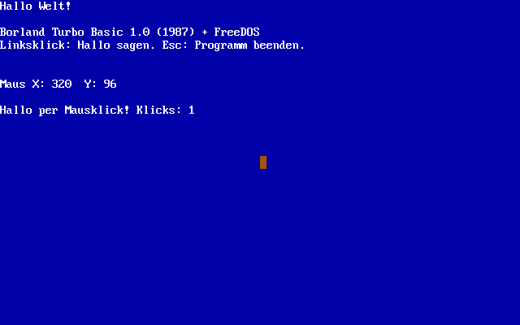
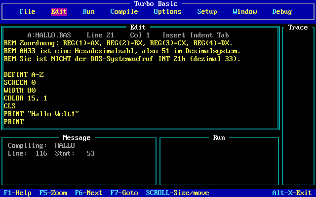
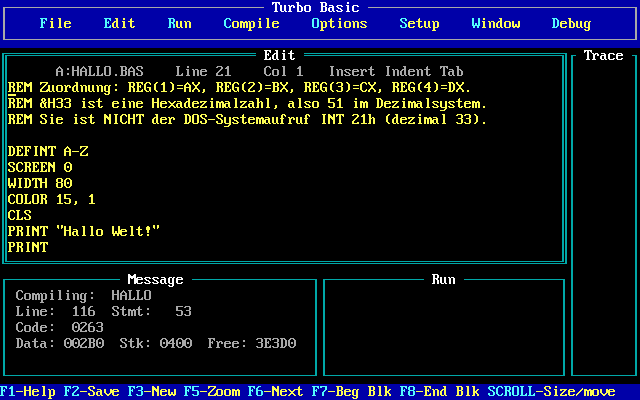
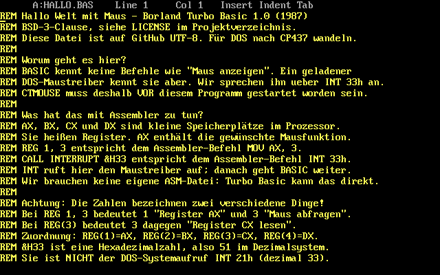

# Hallo Welt mit Maus in Turbo Basic 1.0

Ein kleines „Hallo Welt“ mit Mausunterstützung, geschrieben für **Borland Turbo Basic 1.0 von 1987** und ausgeführt unter **FreeDOS 1.4 in Parallels Desktop auf einem Intel-Mac**.

Ein Linksklick zeigt eine Begrüßung und erhöht den Klickzähler. Das Programm zeigt die Mauskoordinaten an und lässt sich mit **Esc** beenden. Der [BASIC-Quelltext](quelltext/HALLO.BAS) erklärt die Register und Interrupt-Aufrufe Schritt für Schritt auf Deutsch.



## Vom Quelltext zum Mausklick



[Video als MP4 herunterladen](https://github.com/ferraro/turbo-basic-mouse-demo/raw/refs/heads/main/medien/vorfuehrung.mp4)

Die Aufnahme zeigt die echte VM: EXE-Ausgabe auswählen, kompilieren, starten, den Mauszeiger bewegen und mehrmals klicken. Das GIF und das MP4 stammen aus derselben Bildschirmaufnahme. Das MP4 verwendet H.264 und eignet sich als Datei für einen späteren Upload auf X; es wurde nicht auf X veröffentlicht.

## Wie bekommt BASIC eine Maus?

Turbo Basic hat keine eigenen Mausbefehle. Es kann aber mit `REG` Prozessorregister vorbereiten und mit `CALL INTERRUPT` einen geladenen DOS-Maustreiber aufrufen:

```basic
REM AX = 3: Tasten und Position abfragen.
REG 1, 3
CALL INTERRUPT &H33
Taste = REG(2) AND 1
X = REG(3)
Y = REG(4)
```

Das entspricht im Kern diesen Assembler-Befehlen:

```asm
mov ax, 3       ; Mausfunktion 3 auswählen
int 33h         ; den DOS-Maustreiber aufrufen
; Ergebnis: BX = Tasten, CX = X, DX = Y
```

Eine separate ASM-Datei oder selbst geschriebene Maschinencode-Brücke ist dafür nicht nötig. Die Kommentare erklären auch den Unterschied zwischen einer Registernummer und einer Mausfunktionsnummer sowie die Erkennung eines einzelnen Klicks statt einer dauerhaft gedrückten Taste.





Die Menüs und Tastenkürzel der ursprünglichen Borland-IDE bleiben englisch; unser Programm, seine Kommentare und diese Anleitung sind deutsch. Alle drei Bilder sind echte, unveränderte Bildschirmaufnahmen der VM.

## Dateien

| Datei | Zweck |
| --- | --- |
| [`quelltext/HALLO.BAS`](quelltext/HALLO.BAS) | Ausführlich kommentierter Quelltext in UTF-8 |
| [`programm/HALLO.EXE`](programm/HALLO.EXE) | Mit Turbo Basic 1.0 kompilierte DOS-Demo |
| [`konfiguration/`](konfiguration/) | Startdateien für die FreeDOS-Diskette |
| [`skripte/diskette-bauen.py`](skripte/diskette-bauen.py) | Erstellt lokal ein startfähiges Image und wandelt den Quelltext nach CP437 |
| [`skripte/vm-anlegen.sh`](skripte/vm-anlegen.sh) | Legt eine neue DOS-VM in Parallels auf einem Intel-Mac an |
| [`screenshots/`](screenshots/) | Bildschirmaufnahmen von Programm und Quelltext |

**Der originale Compiler ist nicht enthalten.** Auch Borlands Hilfedateien, Handbuch und mitgelieferte Beispiele sowie ein Image mit diesen Dateien werden nicht veröffentlicht. Die einzige EXE im Repo ist das selbst kompilierte Beispielprogramm.

## Voraussetzungen

- Ein Intel-Mac mit Parallels Desktop; getestet mit Version 26.5.
- Python 3 und `mtools` auf dem Rechner, auf dem das Image gebaut wird.
- [FreeDOS 1.4, Floppy Edition](https://download.freedos.org/1.4/FD14-FloppyEdition.zip).
- [CuteMouse 2.0 alpha 4](https://cutemouse.sourceforge.net/download/cutemouse20a4.zip).
- Eine eigene Kopie von Turbo Basic 1.0: `TB.EXE` und `TBHELP.TBH` in einem Verzeichnis.

Auf macOS lässt sich `mtools` mit `brew install mtools` installieren. Das Bauskript verwendet nur die Python-Standardbibliothek und `mtools`.

**Apple Silicon:** Das Image kann auf einem ARM-Mac vorbereitet werden. Für den hier beschriebenen direkten Start in Parallels wird jedoch ein Intel-Mac benötigt: Die x86-Emulation von Parallels auf ARM unterstützt kein Legacy-BIOS und keine 16-Bit-DOS-Gäste. Siehe [Parallels-Dokumentation](https://kb.parallels.com/en/130217).

## Diskette bauen

Lege die beiden ZIP-Dateien und deinen Compiler beispielsweise unter `lokal/` ab. Dieses Verzeichnis wird von Git ignoriert.

```sh
python3 skripte/diskette-bauen.py \
  --freedos lokal/FD14-FloppyEdition.zip \
  --maus lokal/cutemouse20a4.zip \
  --compiler lokal/turbo-basic \
  --ausgabe bau/hallo.img
```

Das Skript nimmt das bootfähige 1,44-MB-Image aus der offiziellen FreeDOS-Distribution, ergänzt CuteMouse, die beiden Compilerdateien, unseren Quelltext und die Demo-EXE. Es lädt nichts selbst herunter und überschreibt kein bereits vorhandenes Ziel.

Die erzeugte Diskette enthält deine Compilerdateien und bleibt lokal. `*.img` ist deshalb ebenfalls in `.gitignore` eingetragen.

## VM starten

Auf dem Intel-Mac:

```sh
./skripte/vm-anlegen.sh "$PWD/bau/hallo.img" "FreeDOS Turbo Basic"
```

Das Skript erstellt ausschließlich eine **neue** VM mit Legacy-BIOS, einer CPU, 32 MB RAM und dem Image als Diskette. Besteht bereits eine VM mit diesem Namen, bricht es ab. Eine Festplatte ist für dieses Beispiel nicht nötig.

FreeDOS startet Turbo Basic automatisch mit `A:\TB\HALLO.BAS`.

| Bedienung | Wirkung |
| --- | --- |
| **Alt+R** | Programm aus der IDE starten |
| **Esc** | Laufendes Beispiel beenden |
| **Alt+E** | Zum Editor wechseln |
| **F2** | Quelltext auf der virtuellen Diskette speichern |
| **F5** | Aktuelles IDE-Fenster vergrößern/verkleinern |
| **Alt+X** | Turbo Basic verlassen |
| `HALLO` am DOS-Prompt `A:\TB>` | Kompilierte EXE starten |

Zum erneuten Kompilieren als EXE: **Options → Compile to → EXE file**, danach **Alt+C**. Die Datei heißt anschließend `A:\TB\HALLO.EXE`.

### Maus einfangen

Klicke ins VM-Fenster, um die Maus einzufangen. **Ctrl+Option/Alt** gibt sie wieder an macOS frei. Der erste Klick kann nur zum Einfangen dienen und muss dann noch einmal im Programm erfolgen.

DOS verwendet relative Mausbewegungen. Der macOS-Zeiger und der DOS-Zeiger werden ohne Gastintegration nicht synchronisiert. Die VM wird deshalb auf **Optimize for games** und **Sticky mouse** eingestellt. Das ist ein Einfangmodus, keine Zeigersynchronisation. Siehe [Parallels zur Mausoptimierung](https://kb.parallels.com/en/6909).

## Dateien zwischen Host und DOS austauschen

Das Diskettenimage enthält ein FAT-Dateisystem. `mtools` kann direkt darauf zugreifen:

```sh
# VM vorher stoppen; niemals gleichzeitig aus DOS und vom Host schreiben!
mdir -i bau/hallo.img ::TB/
mcopy -i bau/hallo.img ::TB/HALLO.EXE ./HALLO.EXE
```

Für einen anderen Parallels-Rechner wird das Image mit `scp` übertragen. Vor Änderungen immer das **aktuellste** Image von dort zurückholen: Mit F2 in DOS gespeicherte Änderungen liegen im Image und nicht automatisch in der Git-Arbeitskopie.

Der GitHub-Quelltext ist UTF-8, die DOS-Datei ist CP437 mit CRLF-Zeilenenden. Das Bauskript erledigt diese Umwandlung. Für die Rückübernahme einer in der IDE editierten Datei:

```sh
mcopy -i bau/hallo.img ::TB/HALLO.BAS ./HALLO-DOS.BAS
python3 - <<'PY'
from pathlib import Path
text = Path('HALLO-DOS.BAS').read_bytes().decode('cp437')
text = text.rstrip('\x1a').replace('\r\n', '\n')
Path('quelltext/HALLO.BAS').write_text(text, encoding='utf-8')
PY
```

## Was auf der getesteten VM nötig war

- **CuteMouse 2.0 alpha 4** verwendet direkten PS/2-Hardwarezugriff. Mit dem zuvor ausprobierten BIOS-basierten Treiber 1.9.1 blieb das Programm hängen. Nach dem Wechsel funktionierten Bewegung, Klicks und das anschließende Beenden. Das ist eine Beobachtung dieser VM, keine allgemeine Aussage gegen die anderen Treiberversionen.
- Das BASIC-Programm setzt den bereits beim Booten initialisierten Maustreiber nicht nochmals mit Funktion 0 zurück.
- `SET 87=no` und `SET CGASNOWCHK=no` sind gesetzt. Diese historischen Turbo-Basic-Optionen deaktivieren die Nutzung des alten 8087-Rechenwegs und die CGA-Schneeprüfung. Sie waren nicht allein ausreichend, um den Hänger zu beheben.
- Die Positionswerte stammen vom Maustreiber. Im Textmodus sind sie keine macOS-Pixelkoordinaten und keine direkten Textspalten.

## Prüfung am laufenden Programm

Geprüft unter FreeDOS 1.4 und Parallels Desktop 26.5 auf einem Intel-Mac:

- Start vom mitgelieferten Bauskript erzeugten Diskettenimage.
- Kompilierung des deutschen `HALLO.BAS` mit Turbo Basic 1.0.
- Anzeige des Mauszeigers und Abfrage der Koordinaten.
- Linksklick mit sichtbarer deutscher Begrüßung und Klickzähler.
- Rückkehr zum DOS-Prompt mit Esc nach der Mausbedienung.

Die Screenshots wurden direkt mit `prlctl capture` aufgenommen. Andere Hypervisoren und reale DOS-PCs wurden nicht geprüft.

## Lizenz

Der neu geschriebene BASIC-Quelltext, die Skripte und die Dokumentation stehen unter **BSD-3-Clause**, siehe [LICENSE](LICENSE). Der standardisierte Lizenztext ist im englischen Original enthalten.

Borland Turbo Basic, FreeDOS und CuteMouse sind eigenständige Drittanbieterprojekte mit eigenen Rechten und Lizenzen. Diese BSD-Lizenz lizenziert sie nicht um. Die kompilierte Demo enthält den von Turbo Basic eingebundenen Laufzeitcode; der originale Compiler wird nicht mitgeliefert. Die Screenshots zeigen die jeweiligen Programme zu Dokumentationszwecken.
